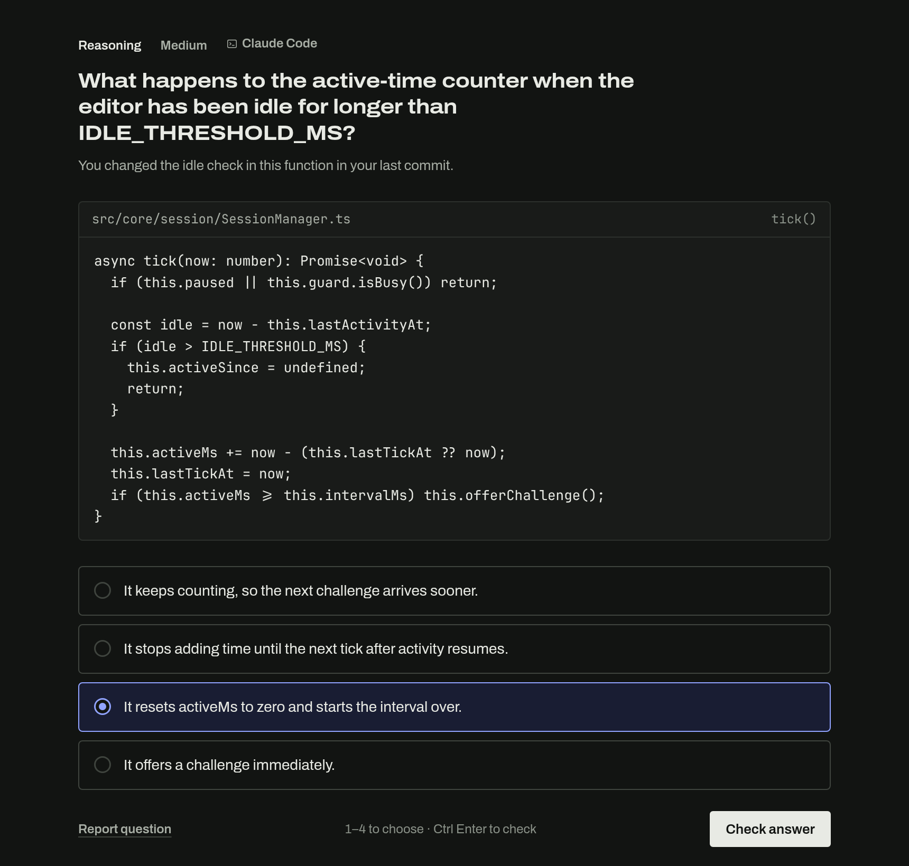
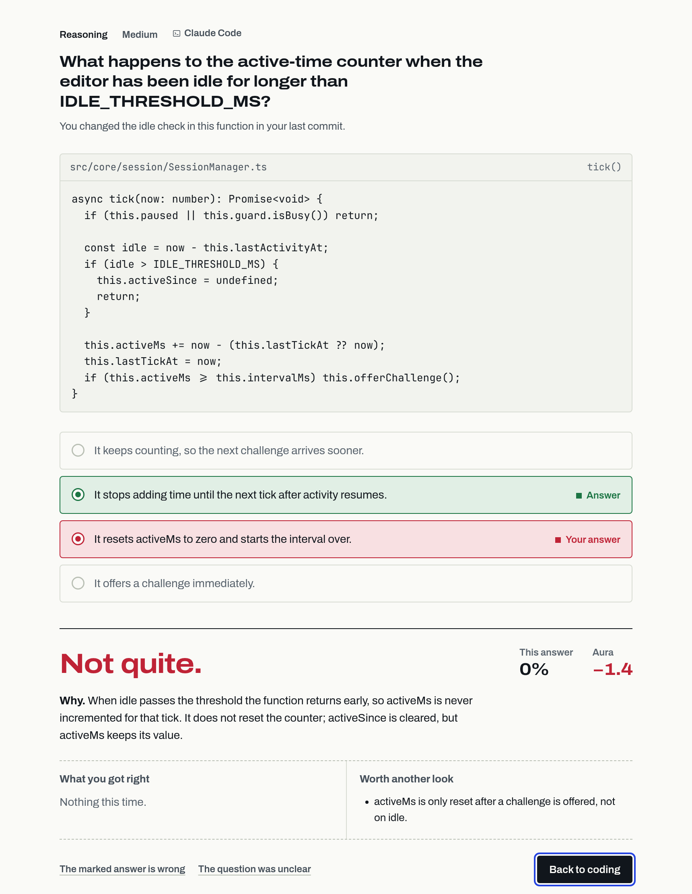
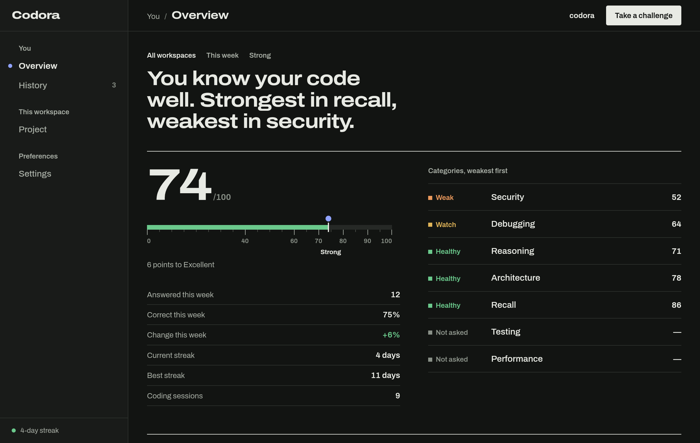

# Codora

**Know the code you ship.**

Codora is a VS Code extension that asks you one short question about code you
just changed: what a function returns, why a guard is there, what breaks if a
line goes. It's multiple choice or a two-line answer, and takes about 30 seconds.
Over time it builds your **aura**, a reading of how well you understand your
own codebase.

AI is allowed. Not understanding your code isn't.



## Why

AI writes more of our code every month, and understanding hasn't kept up.
The gap between the code a team ships and the code its people can explain
now has a name, [comprehension debt](https://addyosmani.com/blog/comprehension-debt/),
and early evidence: in a [2026 Anthropic study](https://www.sovereignmagazine.com/article/anthropic-study-finds-ai-coding-assistants-speed-up-work-but-reduce-skills/),
developers who learned a library with AI help scored about 17 points lower
on a comprehension quiz, with the biggest drop in debugging.

Codora doesn't try to catch AI use. It checks the thing that matters: whether
you can still explain what the code does.

## How it works

- **It asks about your code, not trivia.** Questions come from your recent
  git changes, or recently edited files, and the code is shown with the question.
- **It waits for a good moment.** Questions come after a stretch of *active*
  coding time, never while you're debugging, running tests or mid-git-operation.
- **The answer key is checked.** Before you see a multiple-choice question,
  a model answers it again *without* the key, with the options shuffled, and
  a second model is used if you have one set up. If it disagrees, or finds
  the question ambiguous, the question is thrown away.
- **You can report a bad question.** Mark it wrong, unclear or not about
  your code. A reported answer is taken back out of your scores, and Codora
  stops asking about that code.
- **It comes back later.** Code you were asked about returns as a review 7,
  21 and 60 days later (3 days after a miss). That's your *retention* score:
  whether you still understand what you shipped last month.



## Your aura

A 0–100 reading of how well you know your code, overall and per project,
across recall, reasoning, debugging, architecture, testing, security,
performance and retention. Every category starts at 50; each answer moves it
a quarter of the way toward the result. Every wrong answer lowers it, and one
lucky answer can't max it out.



## Setup

Codora needs a model to write questions. It uses the first one that works:

1. **Claude Code**: picked up automatically if it's installed. No key needed.
2. **Any VS Code chat model**, such as GitHub Copilot Chat. No key needed.
3. **An API key** for Anthropic, OpenAI or Gemini, entered in VS Code's
   masked input and kept in VS Code's secret storage, never in settings.

Run **Codora: Configure AI Provider** from the Command Palette, or pick one in
the challenge panel the first time.

| Command | What it does |
| --- | --- |
| Codora: Start Challenge | Ask a question now |
| Codora: Open Dashboard | Your aura, history and settings |
| Codora: Pause Challenges / Resume Challenges | Stop and restart automatic questions |
| Codora: Configure AI Provider | Choose the model that writes questions |
| Codora: Show Logs | Why a question couldn't be written |

## Privacy

- Your scores, answers and history stay on your machine, in VS Code's local
  storage. There's no account.
- To write a question, Codora sends one short snippet of recent code (a
  function, at most about 3,000 characters) to the model you chose, never
  your whole repository. Written answers go to the same model to be graded.
- **Anonymous usage counts are opt-in** and off by default. Codora asks once,
  and they also stay off whenever VS Code's telemetry is off. When on, they
  include only event names with enum, yes/no and rounded-number fields, such
  as "a question was answered, correct, in under 60 seconds". Never code,
  file names, questions or answers. The full list is
  [`MetricEvent`](src/core/metrics/Metrics.ts), and the server re-checks it
  ([`server/src/validate.ts`](server/src/validate.ts)).

## Development

```bash
npm install
npm run compile   # build the extension and webviews
npm run watch     # rebuild on change
npm test          # unit tests
npm run lint
```

Press **F5** in VS Code to start an Extension Development Host with Codora
loaded. The usage-count server lives in [`server/`](server/README.md) (a
Cloudflare Worker), and the landing page in [`site/`](site/).

## License

[MIT](LICENSE)
